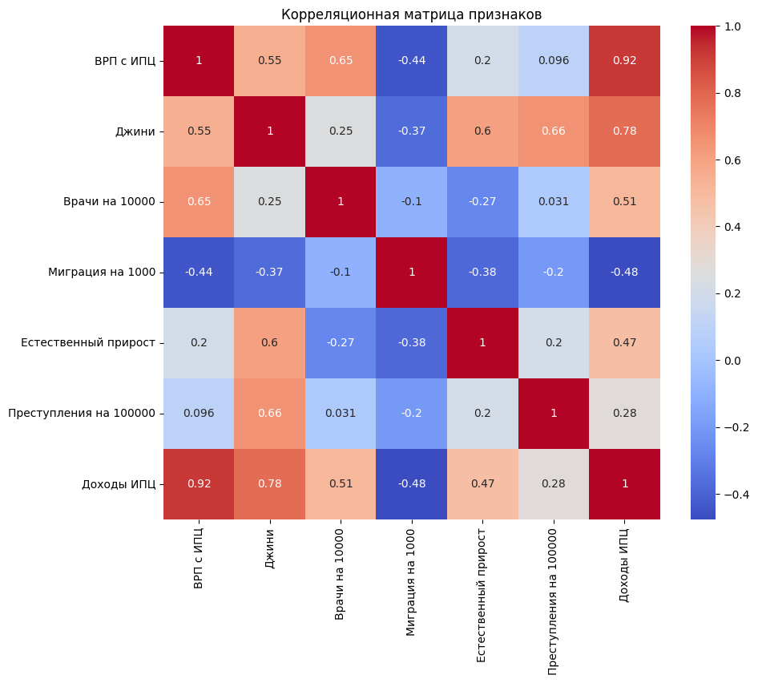

# Эконометрическая модель уровня жизни в Башкортостане

Курсовая по эконометрическому моделированию (3 курс СПбГЭУ, 2025). Вопрос: какие социально-экономические факторы сильнее всего влияют на реальные доходы населения Республики Башкортостан.

[English version below](#english)

## Данные

Годовые ряды Росстата и статсборников Башкортостана за 1998–2023 годы. Целевая переменная: среднедушевые доходы с поправкой на ИПЦ. Кандидаты в факторы: ВРП на душу, инвестиции, безработица, продолжительность жизни, врачи и студенты на 10 тыс. человек, дороги, коэффициент Джини, миграция, естественный прирост, преступность. Всё лежит в `data/`.

## Как строил модель

1. Привёл все ряды к стационарности: логарифм и разности, пока ADF-тест не подтвердит стационарность.
2. Отсеял признаки с ложной корреляцией, то есть те, что коррелируют с доходами только из-за общего тренда.
3. Убрал мультиколлинеарность: из сильно связанных между собой признаков оставлял тот, что сильнее связан с целевой.
4. В gretl перебрал около 50 спецификаций ARIMA с экзогенными переменными. Сравнивал по значимости коэффициентов, AIC/BIC и тестам остатков (нормальность, автокорреляция, ARCH).

## Итоговая модель

ARIMAX(1,2,1) на данных 2001–2023:

Δ²ln(yₜ) = 0,202 + 0,308·Δ²ln(yₜ₋₁) − 0,999·εₜ₋₁ − 0,501·Δ²ln(Джиниₜ) + εₜ

- В модель вошёл один фактор, коэффициент Джини. Рост неравенства тормозит рост реальных доходов: если ускорение роста логарифма индекса Джини увеличивается на 1 п.п., ускорение роста логарифма доходов замедляется примерно на 0,5 п.п.
- R² = 0,987, RMSE = 0,038, AIC = −75. Все параметры значимы, остатки нормальны, автокорреляции и гетероскедастичности нет.

Вывод для экономической политики: одного роста экономики мало, чтобы росли доходы большинства. Нужно ещё сдерживать неравенство.

## Что бы сейчас сделал иначе

- Коэффициент MA близок к −1. Это обычный признак лишнего дифференцирования, так что стоит проверить модель с d = 1 или в уровнях с трендом.
- Наблюдений всего около 20, поэтому R² на таком ряду легко получается высоким. Честнее было бы оценить качество прогноза на последних годах, которые модель не видела.

## Файлы

- `notebooks/data_preparation.ipynb`: стационарность, ложные корреляции, отбор признаков (Python, statsmodels).
- `gretl/model_search.inp`: перебор спецификаций ARIMAX и диагностика остатков.
- `docs/presentation.pdf`: презентация с защиты.

---

## English

**Econometric model of living standards in Bashkortostan.** This was my third-year coursework. It uses annual data for 1998–2023 to find which socio-economic factors drive real per-capita income in the Republic of Bashkortostan.

I made the series stationary (log transforms and differencing, checked with the ADF test), filtered out spurious correlations and multicollinearity in Python, then compared about 50 ARIMAX specifications in gretl. The final ARIMAX(1,2,1) keeps one regressor, the Gini coefficient: rising inequality slows real income growth, with an elasticity of about −0.5. Diagnostics passed (normal residuals, no autocorrelation or heteroskedasticity).

Limitations: the MA term is close to −1, which suggests over-differencing, and the sample is small.
